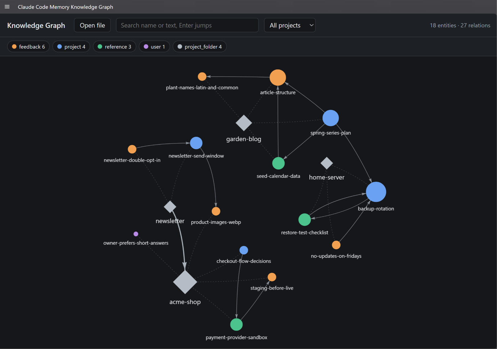
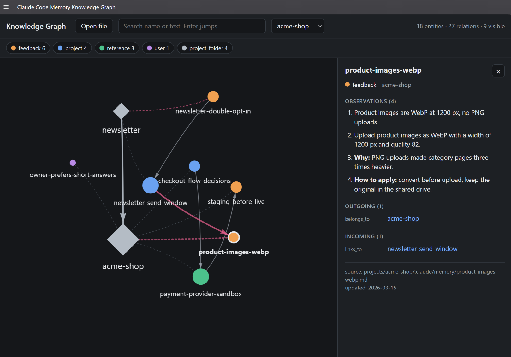

# claude-memory-graph

Mirror the memory files of Claude Code into the knowledge graph of the MCP memory server, and look at the result in a browser.

Claude Code keeps its memory as Markdown files, one folder per project. In a session it sees the memory of the current project only. This tool copies the memory of all projects into one graph file. Claude can then search that graph from any project through the tools of [`@modelcontextprotocol/server-memory`](https://www.npmjs.com/package/@modelcontextprotocol/server-memory), and you can browse it in a single-file viewer.

```
memory files (*.md)
      |
      |  memory-graph-import.py, run when needed
      v
knowledge-graph.jsonl  <-->  MCP memory server  <-->  Claude Code
      |
      v
knowledge-graph-viewer.html (browser)
```

The Markdown files stay the source of truth. The graph is a searchable copy that the import rebuilds on every run.

## Screenshots

The viewer with `example-graph.jsonl`, the invented example data in this repository. Dots are memory entries, coloured by type. Diamonds are project folders.



A click on an entry opens its observations, its relations and the memory file it comes from.



## Contents

| File | Purpose |
|---|---|
| `memory-graph-import.py` | Reads the memory files and writes them into the graph. Python standard library only. |
| `config-example.json` | Template for `config.json`, the settings of the import. |
| `knowledge-graph-viewer.html` | Viewer for the graph file. Runs locally in the browser, nothing is uploaded. |
| `vis-network.min.js` | Graph library used by the viewer, bundled so the viewer works offline. |
| `example-graph.jsonl` | Small graph with invented data to try the viewer. |
| `installation.md` | Requirements, setup and how to use the output. |

## Quick start

1. Install the memory server and register it in Claude Code with the graph file as `MEMORY_FILE_PATH`.
2. Copy `config-example.json` to `config.json` and name the folders that hold your projects.
3. Run `python memory-graph-import.py --dry-run`, then `python memory-graph-import.py`.
4. Open `knowledge-graph-viewer.html` and load the graph file.

The exact commands are in [installation.md](installation.md).

## What ends up in the graph

| In the memory folders | In the graph |
|---|---|
| A memory file | An entity. The name is `name` from the frontmatter, the type is `type`. |
| `description` and every paragraph of the text | One observation each. |
| The place of the file | The observation `source: <root>/<path>`. |
| `modified` from the frontmatter | The observation `updated: <date>`. |
| The project folder | An entity of type `project_folder`. |
| A memory file in its project | The relation `belongs_to`. |
| A subfolder with its own memory | The relation `part_of` to the top folder of the project. |
| `[[name]]` in the text | The relation `links_to`. |

Entities and relations that Claude creates itself through the memory server are not touched by the import.

## Limits

- Names must be unique across all projects. If two memory files share a name, the import stops, names both files and writes nothing.
- Observations that Claude adds to an imported entity are replaced by the next import. The import reports them as "Changed".
- The search of the memory server is a plain substring search without ranking.
- The lock file of the memory server protects the graph on one machine only. If the folder is synchronised between machines, do not write from two of them at the same time.
- The import script and the setup commands are tested on Windows 11 and Ubuntu 20.04, not on macOS. The viewer runs in the browser on any operating system.

## License

MIT, see [license](license). The bundled vis-network library is covered by [third-party-notices.md](third-party-notices.md).

This is an independent project and not affiliated with Anthropic.
